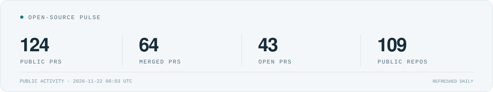

<picture>
  <source media="(prefers-color-scheme: dark) and (max-width: 600px)" srcset="https://raw.githubusercontent.com/shuaiyafei/shuaiyafei/main/assets/hero-mobile-dark.svg?v=3">
  <source media="(max-width: 600px)" srcset="https://raw.githubusercontent.com/shuaiyafei/shuaiyafei/main/assets/hero-mobile-light.svg?v=3">
  <source media="(prefers-color-scheme: dark)" srcset="https://raw.githubusercontent.com/shuaiyafei/shuaiyafei/main/assets/hero-dark.svg?v=3">
  
</picture>

  <a href="https://shuaiyafei.site">Personal website ↗</a>
  &nbsp; · &nbsp;
  <a href="https://github.com/pulls?q=is%3Apr+is%3Apublic+author%3Ashuaiyafei">Open-source work ↗</a>
  &nbsp; · &nbsp;
  <a href="mailto:shuaiyafei@foxmail.com">Say hello ↗</a>

 

I build **web applications, developer tools, and practical AI workflows**.
Mostly TypeScript, with a soft spot for clear APIs and the small details that make software easier to use.

I like understanding a system before changing it, keeping the implementation simple,
and leaving a regression test for the next person who finds that edge case.

## What I build

- **Thoughtful interfaces** — accessible, dependable experiences with React and Vue.
- **Tools for builders** — type-safe APIs, reliable workflows, and less friction between an idea and a working product.
- **Practical AI** — agents and integrations that do something useful.

TypeScript &nbsp; / &nbsp; JavaScript &nbsp; / &nbsp; React &nbsp; / &nbsp; Vue &nbsp; / &nbsp; Node.js &nbsp; / &nbsp; Vite

## Building in the open

I contribute by tracing bugs, tightening types, and making everyday tools a little more reliable.

<picture>
  <source media="(prefers-color-scheme: dark) and (max-width: 600px)" srcset="https://raw.githubusercontent.com/shuaiyafei/shuaiyafei/profile-assets/generated/stats-mobile-dark.svg">
  <source media="(max-width: 600px)" srcset="https://raw.githubusercontent.com/shuaiyafei/shuaiyafei/profile-assets/generated/stats-mobile-light.svg">
  <source media="(prefers-color-scheme: dark)" srcset="https://raw.githubusercontent.com/shuaiyafei/shuaiyafei/profile-assets/generated/stats-dark.svg">
  
</picture>

<!-- MERGED-PRS:START -->
### Recently merged

| Project | Contribution | Merged |
| :-- | :-- | :-- |
| [getmaxun/maxun](https://github.com/getmaxun/maxun) | [#1301 · fix(ai-extract): preserve code fences in JSON values](https://github.com/getmaxun/maxun/pull/1301) | 2026-11-26 |
| [getmaxun/maxun](https://github.com/getmaxun/maxun) | [#1300 · fix(summary): authenticate configured Ollama requests](https://github.com/getmaxun/maxun/pull/1300) | 2026-11-26 |
| [getmaxun/maxun](https://github.com/getmaxun/maxun) | [#1299 · fix(llm): preserve trailing slashes in explicit API keys](https://github.com/getmaxun/maxun/pull/1299) | 2026-11-26 |
| [getmaxun/maxun](https://github.com/getmaxun/maxun) | [#1296 · fix(markdown): preserve MathML comparisons in LaTeX output](https://github.com/getmaxun/maxun/pull/1296) | 2026-11-26 |
| [getmaxun/maxun](https://github.com/getmaxun/maxun) | [#1291 · fix(markdown): preserve encoded redirect destination queries](https://github.com/getmaxun/maxun/pull/1291) | 2026-11-26 |
| [cloudflare/vinext](https://github.com/cloudflare/vinext) | [#4882 · fix(image): constrain legacy intrinsic images to their container](https://github.com/cloudflare/vinext/pull/4882) | 2026-11-25 |

Public upstream contributions · Dates in UTC+8 · Updated daily · <a href="https://github.com/pulls?q=is%3Apublic%20is%3Apr%20is%3Amerged%20author%3Ashuaiyafei%20-user%3Ashuaiyafei">View all merged PRs ↗</a>
<!-- MERGED-PRS:END -->

 

Build with intent. Leave it clearer.

